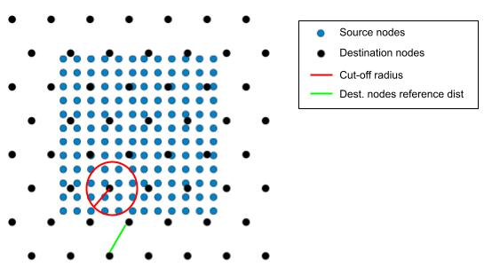

.. _cutoff_radius:

################
 Cut-off radius
################

The *cut-off method* is a method for establishing connections between
two sets of nodes. Given two sets of nodes, (`source`, `target`), the
cut-off method connects all source nodes, :math:`V_{source}`, in a
neighbourhood of the target nodes, :math:`V_{target}`.

The neighbourhood is defined by a `cut-off radius`, which can be
specified in two mutually exclusive ways:

#. **Using cutoff_factor**: The radius is computed as the product of a
   factor and the reference distance:

.. math::

   \texttt{cutoff\_radius} = \texttt{cutoff\_factor} \times \texttt{nodes\_reference\_dist}

where :math:`\texttt{nodes\_reference\_dist}` is the maximum distance
between a target node and its nearest source node.

.. math::

   \texttt{nodes\_reference\_dist} = \max_{x \in V_{target}} \left\{  \min_{y \in V_{source}, y \neq x} \left\{ d(x, y) \right\} \right\}

where :math:`d(x, y)` is the `Haversine distance
<https://en.wikipedia.org/wiki/Haversine_formula>`_ between nodes
:math:`x` and :math:`y`. The :math:`\texttt{cutoff\_factor}` is a parameter
that can be adjusted to increase or decrease the size of the
neighbourhood, and consequently the number of connections in the graph.

2. **Using cutoff_distance_km**: The radius can be directly specified in
   kilometers, which is converted to the appropriate unit sphere
   distance.

To use this method to create your connections, you can use the following
YAML configuration:

.. code:: yaml

   edges:
      # Using cutoff_factor (relative to grid reference distance)
      -  source_name: source
         target_name: destination
         edge_builders:
         -  _target_: anemoi.graphs.edges.CutOffEdges
            cutoff_factor: 0.6
            # max_num_neighbours: 64

      # Or using cutoff_distance_km (direct distance specification)
      -  source_name: source
         target_name: destination
         edge_builders:
         -  _target_: anemoi.graphs.edges.CutOffEdges
            cutoff_distance_km: 300.0
            # max_num_neighbours: 64

The optional argument ``max_num_neighbours`` (default: 64) can be set to
limit the maximum number of neighbours each node can connect to.

.. note::

   The cut-off method is recommended for the encoder edge, to connect
   all data nodes to hidden nodes. The optimal ``cutoff_factor`` value
   will be the lowest value without isolated nodes. This optimal value
   depends on the node distribution, so it is recommended to tune it for
   each case.

#########################
 Reversed Cut-off radius
#########################

The reversed cut-off method (``ReversedCutOffEdges``) is similar to the
standard cut-off method, but instead establishes connections based on
the neighbourhood of each source node. The role of source and target
nodes is similarly reversed in :math:`\texttt{nodes\_reference\_dist}`.
Given two sets of nodes, (`source`, `target`), the
``ReversedCutOffEdges`` method connects all source nodes to all target
nodes within a cut-off radius.

To use this method to create your connections, you can use the following
YAML configuration:

.. code:: yaml

   edges:
      -  source_name: source
         target_name: destination
         edge_builders:
         -  _target_: anemoi.graphs.edges.ReversedCutOffEdges
            cutoff_factor: 0.6

*************************
 Random-sampled cut-off
*************************

When more than ``max_num_neighbours`` source nodes are within the
radius, ``CutOffEdges`` keeps a random subset with pyg-lib and the
nearest ones with sklearn. ``RandomSampledCutOffEdges`` keeps a seeded
random sample of ``num_neighbours`` of them with either backend, so each
target node sees its whole neighbourhood. This is useful when the source nodes are much denser than
the target nodes, for example a fine limited-area grid connected to a
coarse mesh. The sample is fixed by ``random_seed``.

.. code:: yaml

   edges:
      -  source_name: data
         target_name: hidden
         edge_builders:
         -  _target_: anemoi.graphs.edges.RandomSampledCutOffEdges
            cutoff_distance_km: 50
            num_neighbours: 32
            # max_candidates: 1024  # neighbours found before sampling
            # random_seed: 42
