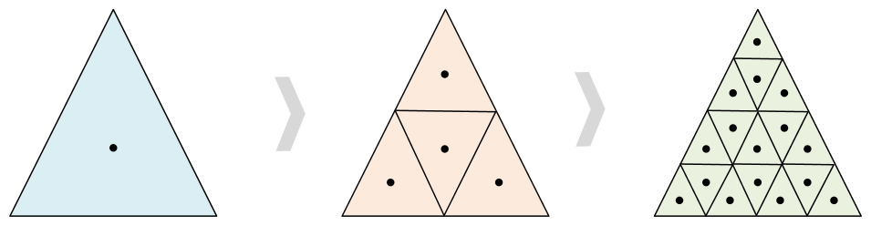

.. _trinodes:

################################
 Triangular refined Icosahedron
################################

This class allows us to define nodes based on iterative refinements of
an icosahedron with triangles. This method generates an icosahedron
projected onto a sphere, where the vertices are the nodes of the graph.
The icosahedron can be refined iteratively, with each refinement
dividing each triangular face into four smaller triangles. A key
property of these methods is that all nodes from a given refinement
level are retained in subsequent refinements.

To define the `node coordinates` based on icosahedral refinements of an
icosahedron, you can use the following YAML configurations:

***************
 Global graphs
***************

The class `TriNodes` allows us to define the nodes over the entire globe

.. code:: yaml

   nodes:
     hidden: # name of the nodes
       node_builder:
         _target_: anemoi.graphs.nodes.TriNodes
         resolution: 4
       attributes: ...

where `resolution` is the number of refinements to be applied to the
icosahedron.

*********************
 Limited Area graphs
*********************

The class `LimitedAreaTriNodes` allows us to define the nodes only for a
specific area of interest.

.. code:: yaml

   nodes:
     hidden: # name of the nodes
       node_builder:
         _target_: anemoi.graphs.nodes.LimitedAreaTriNodes
         resolution: 4
         reference_node_name: nodes_name
         mask_attr_name: mask_name  # optional
         margin_radius_km: 100  # optional
       attributes: ...

where `reference_node_name` is the name of the nodes to define the area
of interest. These nodes must be defined in the recipe beforehand.

*****************
 Stretched graph
*****************

The class `StretchedTriNodes` allows us to define the nodes with a
different resolution for inside and outside the area of interest.

.. code:: yaml

   nodes:
     hidden: # name of the nodes
       node_builder:
         _target_: anemoi.graphs.nodes.StretchedTriNodes
         global_resolution: 3
         lam_resolution: 5
         reference_node_name: nodes_name
         mask_attr_name: mask_name  # optional
         margin_radius_km: 100  # optional
       attributes: ...

where `resolution` argument is dropped divided into `global_resolution`
and `lam_resolution`, which are the number of refinements to be applied
to the icosahedron outside and inside the area of interest respectively.

.. csv-table:: Triangular refinements specifications
   :file: ./tri_nodes.csv
   :header-rows: 1

.. warning::

   This class will require the `trimesh <https://trimesh.org>`_ package
   to be installed. You can install it with `pip install trimesh`.

**************************
 Adaptive stretched graph
**************************

The class `AdaptiveStretchedTriNodes` builds the same mesh as `StretchedTriNodes`
and then adds nodes where an attribute of your choice has large
gradients inside the area of interest. The attribute is read from the
reference nodes, so those nodes must come first in the graph config. For
every edge of the ``lam_resolution`` icosahedron
whose two end nodes are among those with the largest gradients, a node
is added at the edge midpoint. With surface geopotential, for example,
this halves the local node spacing over complex
terrain without refining the whole area of interest.

.. code:: yaml

   nodes:
     data:
       node_builder: ...
       attributes:
         z_orog:
           _target_: anemoi.graphs.nodes.attributes.AnemoiDatasetVariableWeights
           variable: z
           norm: unit-max
     hidden: # name of the nodes
       node_builder:
         _target_: anemoi.graphs.nodes.AdaptiveStretchedTriNodes
         global_resolution: 7
         lam_resolution: 10
         reference_node_name: data
         reference_node_attr_name: z_orog
         gradient_threshold_percentile: 75  # optional, refines the top 25%
         gradient_num_neighbours: 12  # optional
         mask_attr_name: cutout_mask  # optional
         margin_radius_km: 100  # optional
       attributes: ...

The gradient at each point comes from a plane fitted to its
``gradient_num_neighbours`` nearest reference nodes. The result depends
on the resolution of the reference nodes: a field on a grid coarser
than the mesh gives smoother gradients.

The added nodes are vertices of the ``lam_resolution + 1`` icosahedron,
so the nodes support `MultiScaleEdges` with ``scale_resolutions:
lam_resolution + 1``. Nodes with a gradient of 0 are never refined.

.. warning::

   This class will require the `trimesh <https://trimesh.org>`_ package
   to be installed. You can install it with `pip install trimesh`.

**************************************
 Field-following nodes without a grid
**************************************

Two more builders place nodes according to the gradient of an attribute
of the reference nodes, without keeping the icosahedron structure. Neither supports
`MultiScaleEdges`, so connect their nodes with `KNNEdges` or
`CutOffEdges`.

`ProbabilisticStretchedTriNodes` builds the same mesh as
`StretchedTriNodes` and adds ``extra_nodes_percent`` % more nodes inside
the area of interest. Candidates on a 0.02° grid are taken from the
largest gradient to the smallest, and each is kept only if it is at
least ``min_dist_factor`` times the ``lam_resolution`` node spacing from
every other node. Nodes with a gradient of 0 are skipped.

.. code:: yaml

   nodes:
     hidden:
       node_builder:
         _target_: anemoi.graphs.nodes.ProbabilisticStretchedTriNodes
         global_resolution: 7
         lam_resolution: 10
         reference_node_name: data
         reference_node_attr_name: z_orog
         extra_nodes_percent: 10  # optional
         min_dist_factor: 0.5  # optional

`ProbabilisticNodes` builds a free-form mesh with a fixed number of
nodes inside and outside the area of interest. Candidates are visited in
a random order that favours large gradients, with weights ``(g + 1e-6)
** (1 / compression)`` where ``g`` is the gradient relative to its
maximum, and each is kept if it is at least ``min_dist_km`` from every
node placed so far. A small ``compression`` (e.g. 0.1) concentrates the
nodes where the gradient is large; a large one (e.g. 10) spreads them
uniformly.

.. code:: yaml

   nodes:
     hidden:
       node_builder:
         _target_: anemoi.graphs.nodes.ProbabilisticNodes
         reference_node_name: data
         reference_node_attr_name: z_orog
         num_nodes_global: 40000
         num_nodes_lam: 60000
         compression_global: 10
         compression_lam: 0.1
         min_dist_km: 5  # optional
         random_seed: 42  # optional
