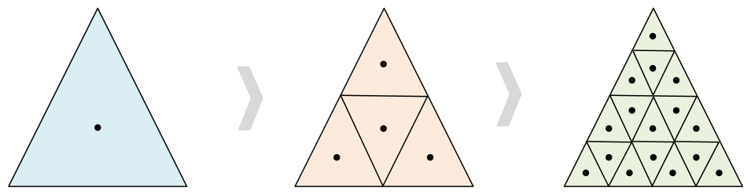

.. _trinodes:

################################
 Triangular refined Icosahedron
################################

This class allows us to define nodes based on iterative refinements of
an icosahedron with triangles. This method generates an icosahedron
projected onto a sphere, where the vertices are the nodes of the graph.
The icosahedron can be refined iteratively, with each refinement
dividing each triangular face into four smaller triangles. A key
property of these methods is that all nodes from a given refinement
level are retained in subsequent refinements.

To define the `node coordinates` based on icosahedral refinements of an
icosahedron, you can use the following YAML configurations:

***************
 Global graphs
***************

The class `TriNodes` allows us to define the nodes over the entire globe

.. code:: yaml

   nodes:
     hidden: # name of the nodes
       node_builder:
         _target_: anemoi.graphs.nodes.TriNodes
         resolution: 4
       attributes: ...

where `resolution` is the number of refinements to be applied to the
icosahedron.

By default the nodes are sorted by latitude and longitude. With
``ordering: diamonds`` they are stored diamond by diamond instead: the
twenty faces of the icosahedron pair up into ten diamonds, each refined
into a regular ``2**resolution`` by ``2**resolution`` lattice, stored
row by row, with the two vertices left over first and last. This is the
order the icosahedral neighbourhood attention kernels of anemoi-models
work in. It needs the whole globe, so it is only available for
`TriNodes`.

.. code:: yaml

   nodes:
     hidden:
       node_builder:
         _target_: anemoi.graphs.nodes.TriNodes
         resolution: 6
         ordering: diamonds

*********************
 Limited Area graphs
*********************

The class `LimitedAreaTriNodes` allows us to define the nodes only for a
specific area of interest.

.. code:: yaml

   nodes:
     hidden: # name of the nodes
       node_builder:
         _target_: anemoi.graphs.nodes.LimitedAreaTriNodes
         resolution: 4
         reference_node_name: nodes_name
         mask_attr_name: mask_name  # optional
         margin_radius_km: 100  # optional
       attributes: ...

where `reference_node_name` is the name of the nodes to define the area
of interest. These nodes must be defined in the recipe beforehand.

*****************
 Stretched graph
*****************

The class `StretchedTriNodes` allows us to define the nodes with a
different resolution for inside and outside the area of interest.

.. code:: yaml

   nodes:
     hidden: # name of the nodes
       node_builder:
         _target_: anemoi.graphs.nodes.StretchedTriNodes
         global_resolution: 3
         lam_resolution: 5
         reference_node_name: nodes_name
         mask_attr_name: mask_name  # optional
         margin_radius_km: 100  # optional
       attributes: ...

where `resolution` argument is dropped divided into `global_resolution`
and `lam_resolution`, which are the number of refinements to be applied
to the icosahedron outside and inside the area of interest respectively.

.. csv-table:: Triangular refinements specifications
   :file: ./tri_nodes.csv
   :header-rows: 1

.. warning::

   This class will require the `trimesh <https://trimesh.org>`_ package
   to be installed. You can install it with `pip install trimesh`.
