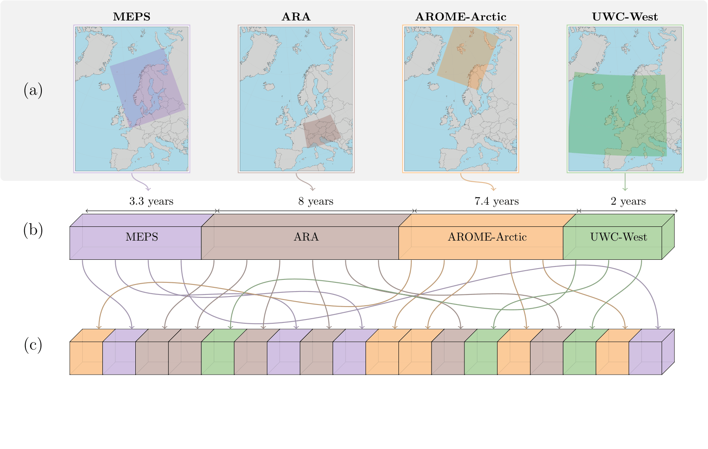
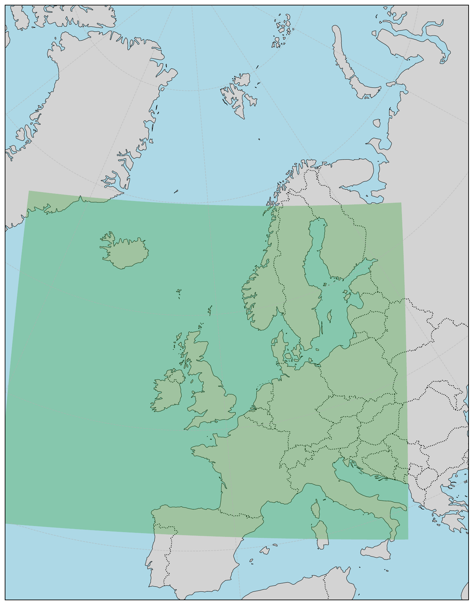

#####################
Multi-Domain Training
#####################

Multi-domain training enables a single model to be trained on several domains that are loaded independently: each batch is drawn from one domain, and the same model parameters are updated across all domains.

A **domain** is the spatial structure of a dataset: its grid, resolution, geographical extent, and number of nodes. All domains are assumed to share the same variables, so variables do not distinguish one domain from another. A typical use case is a set of stretched-grid domains that share a global dataset but each combine it with a different regional dataset. Multi-domain training supports different spatial resolutions, grid structures, and geographical extents, making it useful for applications such as downscaling, combining global and regional datasets, and improving model generalisation across domains and resolutions.

Overview
********

In multi-domain training, the same model processes datasets with different spatial grids and numbers of nodes. Each training iteration selects data from one of the configured datasets and uses its corresponding graph. The shared encoder maps the input to a latent representation, the shared processor operates on that representation, and the shared decoder produces predictions on the selected dataset's grid. All datasets contribute to updating the same model parameters, allowing the model to learn across different domains and resolutions.

Domains may cover different geographical regions and do not need to overlap spatially, although stretched-grid domains typically share the same global dataset. They can also have dataset-specific readers, preprocessing settings, and normalisation statistics, provided the resulting inputs and outputs are compatible with the shared architecture.

.. warning::

   Datasets must use compatible input and output variable definitions and consistent variable ordering. Dataset-specific preprocessing and normalisation do not remove this requirement.

Training Procedure
******************

Multi-domain training aims to learn a representation that generalises across spatial domains and resolutions. During training, data and the corresponding graph are selected from the configured datasets according to the sampling strategy. The shared encoder, processor, and decoder then process the batch, after which the loss is calculated and the shared parameters are updated. The selected grid, resolution, and number of spatial nodes may change between iterations, while the model parameters remain shared.

The following illustration shows multi-domain training with datasets that differ in their spatial characteristics.

The animation below shows datasets passing through the model during training.

Multi-domain models can be trained using deterministic objectives, probabilistic objectives such as the Continuous Ranked Probability Score (CRPS), or transport objectives such as EDM diffusion.

Dataset Configuration
*********************

The dataset reader configuration under ``dataloader.training.datasets`` is the same regardless of how the datasets are loaded, see :doc:`multiple-encoder-decoder`. The following example defines two stretched-grid domains, ``sg_1`` and ``sg_2``. Each cuts a different regional dataset into the same global dataset, so the domains differ only in their regional part:

.. code-block:: yaml

   dataloader:
       selected_variables: [...]
       sg_1:
           dataset:
               cutout:
               - dataset: /path/to/regional_1.zarr
                 trim_edge: 50
               - /path/to/global.zarr
               adjust: all
               min_distance_km: 0
               statistics: /path/to/global.zarr
           select: ${dataloader.selected_variables}
       sg_2:
           dataset:
               cutout:
               - dataset: /path/to/regional_2.zarr
                 trim_edge: 50
               - /path/to/global.zarr
               adjust: all
               min_distance_km: 0
               statistics: /path/to/global.zarr
           select: ${dataloader.selected_variables}
       training:
           datasets:
               sg_1:
                   dataset_config: ${dataloader.sg_1}
                   start: 2020-02-05
                   end: 2023-12-31
               sg_2:
                   dataset_config: ${dataloader.sg_2}
                   start: 2022-02-01
                   end: 2023-12-31

Each domain is defined once and referenced from the training, validation and test sections, and from the graph recipe (see below). The shared ``select`` list and the shared ``statistics`` source keep the variables, their order and their normalisation consistent across domains, while the date ranges may differ.

Loading Policy and Model Configuration
**************************************

Multi-domain training is enabled by selecting the multi-domain loading policy, which builds one independently indexed dataset per domain and keeps every batch domain-homogeneous:

.. code-block:: yaml

   dataloader:
       loading_policy:
           _target_: anemoi.training.data.loading.MultiDomainLoadingPolicy

The model must then name the hidden mesh of each dataset under ``model.model.hidden_nodes_name`` and list the datasets that share an encoder or decoder group under ``source_datasets`` and ``target_datasets``. The configuration is described in :doc:`/modules/data`, and a complete example is the top-level ``multidomain`` configuration.

The following constraints apply:

- Hierarchical models do not support per-dataset hidden meshes.
- All datasets must have the same variables in the same order, because the shared encoder and decoder weights are tied to the variable position.
- Hidden node and edge feature dimensions must match across the hidden meshes, because the weights are shared.
- Trainable node and edge parameters must be set to 0, because the active graph-specific parameters would change between batches.

Graph Creation
**************

Each domain needs its own data nodes, named after the dataset, and its own hidden mesh, because the hidden mesh of a stretched-grid domain is refined around that domain's region. The graph recipe must therefore define, for every domain, the data nodes, the hidden mesh, and the corresponding data-to-hidden, hidden-to-hidden, and hidden-to-data edges. During training, the graph of the selected domain is used to encode and decode its spatial representation, while the encoder, processor, and decoder parameters remain shared. The hidden meshes may differ in size and structure, provided they are compatible with the shared model architecture.

For the stretched-grid domains ``sg_1`` and ``sg_2`` defined above, the data nodes are built from each domain's dataset reader and the hidden meshes are stretched around each domain's own regional area:

.. code-block:: yaml

   nodes:
       sg_1:
           node_builder:
               _target_: anemoi.graphs.nodes.AnemoiDatasetNodes
               dataset: ${dataloader.sg_1}
           attributes: ${graph.attributes.nodes}
       sg_1_hidden:
           node_builder:
               _target_: anemoi.graphs.nodes.StretchedTriNodes
               lam_resolution: 10
               global_resolution: 7
               reference_node_name: sg_1
               mask_attr_name: cutout_mask
               margin_radius_km: 11
       sg_2:
           node_builder:
               _target_: anemoi.graphs.nodes.AnemoiDatasetNodes
               dataset: ${dataloader.sg_2}
           attributes: ${graph.attributes.nodes}
       sg_2_hidden:
           node_builder:
               _target_: anemoi.graphs.nodes.StretchedTriNodes
               lam_resolution: 10
               global_resolution: 7
               reference_node_name: sg_2
               mask_attr_name: cutout_mask
               margin_radius_km: 11

The ``cutout_mask`` node attribute, defined under ``graph.attributes.nodes`` with ``anemoi.graphs.nodes.attributes.CutOutMask``, marks the regional part of each domain. The edges are defined per domain; for ``sg_1``:

.. code-block:: yaml

   edges:
   - source_name: sg_1
     target_name: sg_1_hidden
     edge_builders:
     - _target_: anemoi.graphs.edges.KNNEdges
       num_nearest_neighbours: 12
     attributes: ${graph.attributes.edges}
   - source_name: sg_1_hidden
     target_name: sg_1_hidden
     edge_builders:
     - _target_: anemoi.graphs.edges.MultiScaleEdges
       x_hops: 1
       scale_resolutions: 5
     attributes: ${graph.attributes.edges}
   - source_name: sg_1_hidden
     target_name: sg_1
     edge_builders:
     - _target_: anemoi.graphs.edges.KNNEdges
       num_nearest_neighbours: 3
     attributes: ${graph.attributes.edges}

and analogously for ``sg_2``. The corresponding hidden nodes must then be mapped to their respective datasets in the model configuration, located under ``config/model/`` (see the processor section):

.. code-block:: yaml

   model:
       num_channels: ...
       condition_on_residual: ...
       cpu_offload: ...
       keep_batch_sharded: ...
       model:
           _target_: ...
           hidden_nodes_name:
               sg_1: sg_1_hidden
               sg_2: sg_2_hidden
