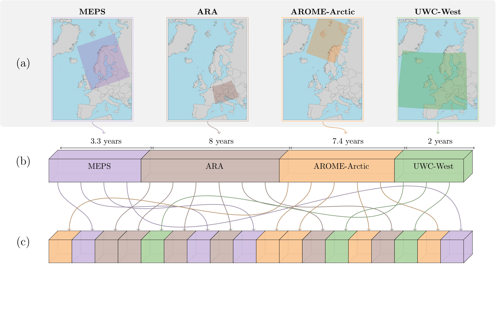
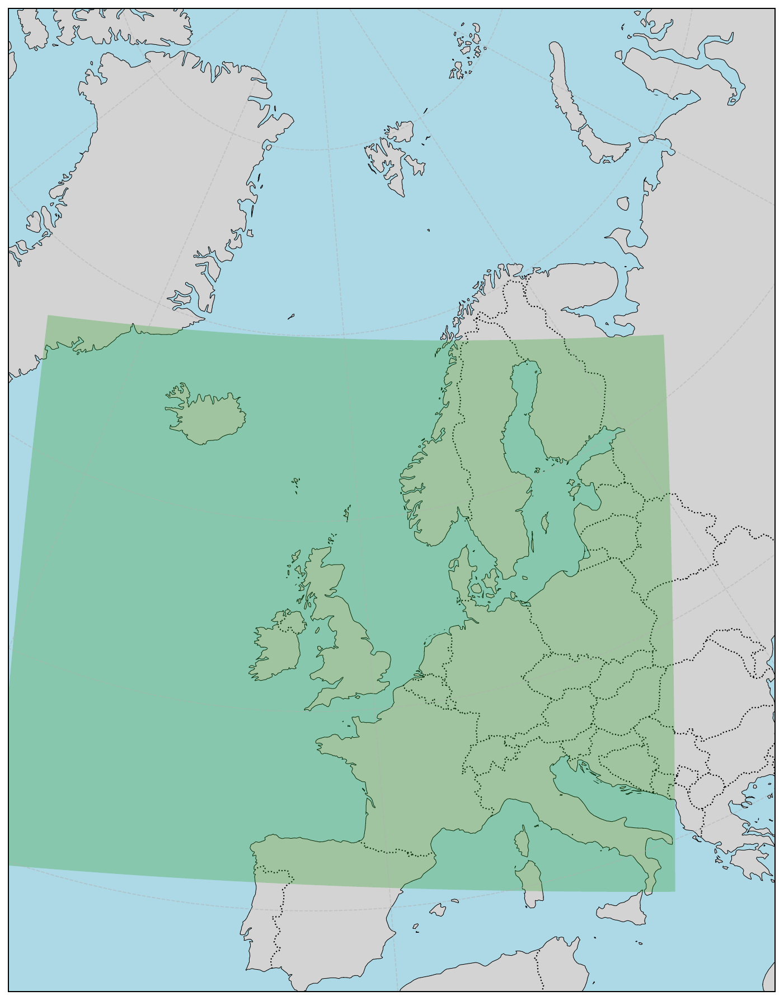

#####################
Multi-Domain Training
#####################

Multi-domain training is an additional option to the default multi-dataset training described in :doc:`multi-datasets`. Both train a single model on several datasets, but they differ in the data loading policy (``dataloader.loading_policy``). By default, synchronized loading is used, where every sample contains data from all configured datasets. Multi-domain training is enabled by selecting a different loading policy, see `Loading Policy and Model Configuration`_ below.

Multi-domain training alternates domain-homogeneous batches within one training workflow: each batch is drawn from one domain, the active spatial grid and graph can change between batches, and the same model parameters are updated across all domains.

A **domain** is the spatial structure of a dataset: its grid, resolution, geographical extent, and number of nodes. Domains normally share the same ordered variables. With a variable-aware input transform, they may instead expose different subsets of a common vocabulary. A typical use case is a set of stretched-grid domains that share a global dataset but each combine it with a different regional dataset. Multi-domain training supports different spatial resolutions, grid structures, and geographical extents, making it useful for applications such as downscaling, combining global and regional datasets, and improving model generalisation across domains and resolutions.

.. note::
    Multi-domain training can be used in a variety of settings: forecasting or temporal downscaling, with deterministic, probabilistic (e.g. CRPS ensemble) or transport (e.g. EDM diffusion) objectives, and with global, limited-area (LAM) or stretched-grid domains.

Overview
********

In multi-domain training, the same model processes datasets with different spatial grids and numbers of nodes. Each training iteration selects data from one of the configured datasets and uses its corresponding graph. The shared encoder maps the input to a latent representation, the shared processor operates on that representation, and the shared decoder produces predictions on the selected dataset's grid. All datasets contribute to updating the same model parameters, allowing the model to learn across different domains and resolutions.

Domains may cover different geographical regions and do not need to overlap spatially, although stretched-grid domains typically share the same global dataset. They can also have dataset-specific readers, preprocessing settings, and normalisation statistics, provided the resulting inputs and outputs are compatible with the shared architecture.

.. note::

   Positional encoders and shared decoders still require compatible ordered variables. Heterogeneous input variables require a variable tokenizer. If output variables differ, configure dataset-specific decoder groups; each dataset's loss then includes only the variables produced for that dataset.

Training Procedure
******************

Multi-domain training aims to learn a representation that generalises across spatial domains and resolutions. During training, data and the corresponding graph are selected from the configured datasets according to the sampling strategy. The shared encoder, processor, and decoder then process the batch, after which the loss is calculated and the shared parameters are updated. The selected grid, resolution, and number of spatial nodes may change between iterations, while the model parameters remain shared.

The following illustration shows multi-domain training with datasets that differ in their spatial characteristics.

The animation below shows datasets passing through the model during training.

Dataset Configuration
*********************

The dataset reader configuration under ``dataloader.training.datasets`` is the same regardless of how the datasets are loaded, see :ref:`multi-dataset-reader-configuration`. Using the same ``select`` list and the same ``statistics`` source for all domains keeps the variables, their order and their normalisation consistent across domains.

Loading Policy and Model Configuration
**************************************

Multi-domain training is enabled by selecting the multi-domain loading policy, which builds one independently indexed dataset per domain and keeps every batch domain-homogeneous:

.. code-block:: yaml

   dataloader:
       loading_policy:
           _target_: anemoi.training.data.loading.MultiDomainLoadingPolicy

By default the policy verifies identical variable ordering. A variable-aware model can allow different domain subsets explicitly:

.. code-block:: yaml

   dataloader:
       loading_policy:
           _target_: anemoi.training.data.loading.MultiDomainLoadingPolicy
           allow_heterogeneous_variables: true

The graph must define the data nodes (named after the dataset), the hidden mesh and the connecting edges of every domain. The model must then name the hidden mesh of each dataset under ``model.model.hidden_nodes_name`` and list the datasets that share an encoder or decoder group under ``source_datasets`` and ``target_datasets``. The configuration is described in :doc:`/modules/data`, and a complete example is the top-level ``multidomain`` configuration.

The following constraints apply:

- Hierarchical models do not support per-dataset hidden meshes.
- Datasets sharing a positional encoder or decoder must have the same variables in the same order.
- Heterogeneous input sets require ``allow_heterogeneous_variables: true`` and a variable tokenizer. Heterogeneous output sets require dataset-specific decoder groups.
- Hidden node and edge feature dimensions must match across the hidden meshes, because the weights are shared.
- Trainable node and edge parameters must be set to 0, because the active graph-specific parameters would change between batches.

For example, for two domains ``domain_1`` and ``domain_2``, the hidden meshes are named in the model configuration, located under ``config/model/``:

.. code-block:: yaml

   model:
       num_channels: ...
       condition_on_residual: ...
       cpu_offload: ...
       keep_batch_sharded: ...
       model:
           _target_: ...
           hidden_nodes_name:
               domain_1: hidden_1
               domain_2: hidden_2
